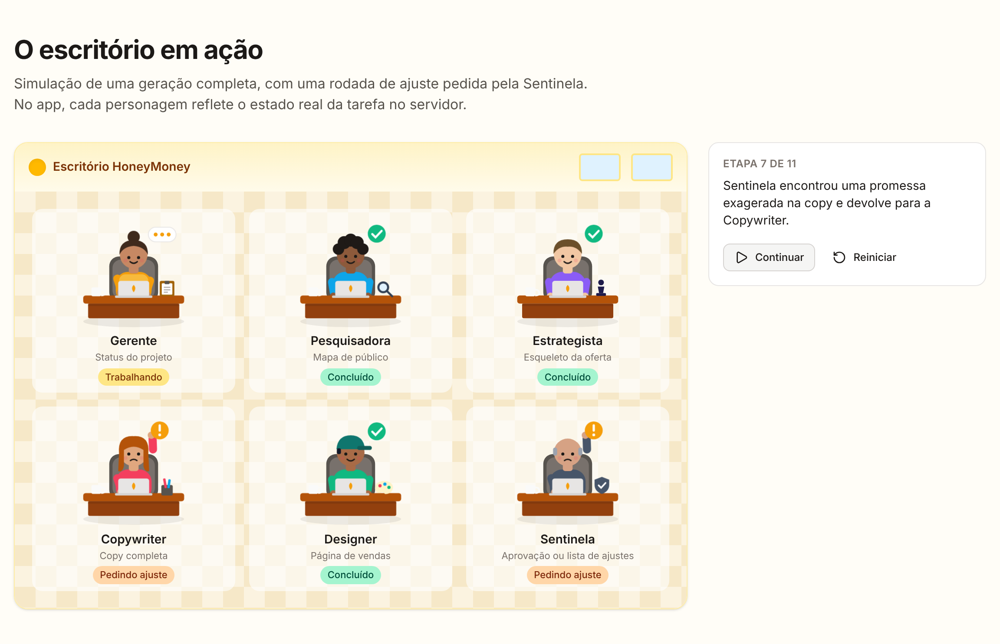

<div align="center">

# 🍯 HoneyMoney

**Plataforma gratuita y de código abierto donde agentes de IA ayudan a cualquier persona a crear, desde cero, una oferta digital.**

Producto, página de ventas y copy, hechos por un equipo de agentes que puedes ver trabajando en una oficina animada.
Usa tu propia clave de IA. Sin suscripciones, sin moneda interna, sin promesas de ingresos.

[English](README.md) · [Português (Brasil)](README.pt-BR.md) · **Español**


</div>

## Qué hace

Para principiantes que quieren vender un producto digital propio (e-book, curso, planilla, plantilla, mentoría) sin pagar una suscripción cara para empezar.

1. **Un briefing corto:** lo que sabes, a quién quieres ayudar, el formato y el precio que imaginas.
2. **Los agentes trabajan en secuencia:** Gerente (coordina y pregunta cuando falta información), Investigadora (público, dolores y objeciones), Estratega (promesa, formato, precio y estructura), Copywriter (página, e-mails y anuncios), Diseñador (página en bloques) y Centinela (revisa promesas de ingresos, afirmaciones de salud, resultados garantizados, precio, idioma y texto copiado).
3. **La Centinela revisa.** Si algo está mal, vuelve solo al agente responsable, con la lista de ajustes.
4. **Tú editas y publicas** la página en su propio subdominio, con tu enlace de pago.



> La interfaz del MVP está en portugués; las ofertas se pueden generar en portugués, español o inglés. ¡Traducciones de la interfaz son bienvenidas!

## Principios

- **Gratis de verdad:** sin planes pagos ni moneda interna. El costo de IA lo paga quien lo ejecuta (tu clave o el modelo gratuito de la instancia, con límite diario).
- **Honesto:** ninguna promesa ni estimación de ingresos.
- **Crear valor, no apostar:** trading, opciones binarias, apuestas y esquemas de "socio" quedan fuera.
- **Abierto:** AGPL-3.0, fácil de alojar y de contribuir.

## Instalación rápida

Requisitos: Node.js 22, pnpm 10 y Docker (para Supabase local).

```bash
git clone https://github.com/NyxPjct/HoneyMoney.git && cd HoneyMoney
```

```bash
pnpm install
```

```bash
pnpm db:start
```

```bash
cp .env.example apps/web/.env.local
```

Completa `NEXT_PUBLIC_SUPABASE_ANON_KEY` y `SUPABASE_SERVICE_ROLE_KEY` con los valores que muestra `pnpm db:start` y ejecuta:

```bash
pnpm dev
```

Abre http://localhost:3000. Despliegue en producción: [docs/installation.md](docs/installation.md) (en inglés).

## Seguridad

Claves de IA en Supabase Vault (solo el servidor las descifra; nunca llegan al navegador ni a los logs), RLS en todas las tablas, contenido de terceros como datos delimitados en los prompts, páginas publicadas con CSP estricta en un subdominio separado. Para reportar fallas, ver [SECURITY.md](SECURITY.md).

## Contribuir y licencia

Lee [CONTRIBUTING.md](CONTRIBUTING.md). Licencia [AGPL-3.0](LICENSE).
