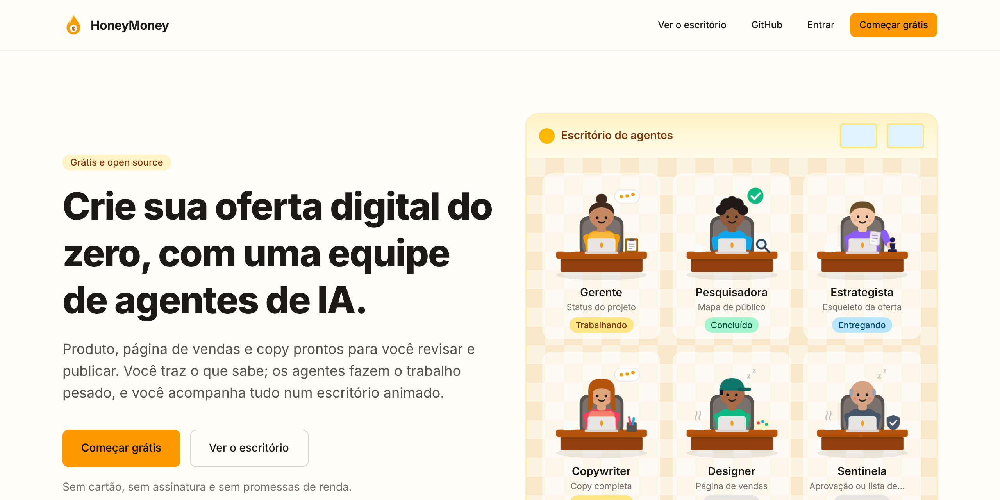
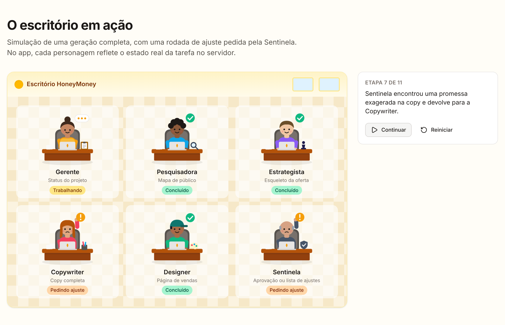

<div align="center">

# 🍯 HoneyMoney

**Plataforma grátis e open source em que agentes de IA ajudam qualquer pessoa a criar, do zero, uma oferta digital.**

Produto, página de vendas e copy, feitos por uma equipe de agentes que você acompanha num escritório animado.
Use sua própria chave de IA. Sem assinatura, sem moeda interna, sem promessas de renda.

[English](README.md) · **Português (Brasil)** · [Español](README.es.md)



</div>

## O que faz

Para iniciantes que querem vender um produto digital próprio (e-book, curso, planilha, template, mentoria) sem pagar uma assinatura cara para começar.

1. **Briefing curto:** o que você sabe, quem quer ajudar, formato e preço que imagina.
2. **Os agentes trabalham em sequência**, cada um na sua mesa:

   | Agente | Papel | Entrega |
   | --- | --- | --- |
   | Gerente | Coordena a fila e pergunta quando falta informação | Status do projeto |
   | Pesquisadora | Mapeia nicho, dores e objeções do público | Mapa de público |
   | Estrategista | Define promessa, formato, preço sugerido e estrutura | Esqueleto da oferta |
   | Copywriter | Escreve headline, página de vendas, e-mails e anúncios | Copy completa |
   | Designer | Monta a página em blocos | Página de vendas |
   | Sentinela | Revisa tudo: promessas de renda, alegações de saúde, resultado garantido, preço, português, texto copiado | Aprovação ou lista de ajustes |

3. **A Sentinela revisa.** Se algo estiver errado, volta só para o agente responsável, com a lista de ajustes.
4. **Você edita e publica.** Edite qualquer entrega, cole o link do seu checkout e publique a página num subdomínio.



## Princípios

- **Grátis de verdade:** sem plano pago e sem moeda interna. O custo de IA é de quem roda (sua chave ou o modelo gratuito da instância, com limite diário).
- **Honesto:** nenhuma promessa ou estimativa de renda. A Sentinela barra com regras determinísticas e revisão do modelo.
- **Criar valor, não apostar:** trading, opções binárias, apostas e esquemas de "sócio" ficam de fora.
- **Aberto:** AGPL-3.0, fácil de hospedar e de contribuir.

## Baixar

- **Qualquer navegador:** instale como app (PWA) pelo Chrome ou Edge, ou no iPhone pelo Safari → Compartilhar → *Adicionar à Tela de Início*.
- **Windows, macOS, Linux e Android:** instaladores na [versão mais recente](https://github.com/NyxPjct/HoneyMoney/releases/latest). Na primeira abertura, o app pergunta o endereço do servidor HoneyMoney que você usa.

Detalhes: [docs/desktop-mobile.md](docs/desktop-mobile.md) (em inglês).

## Instalação rápida

Requisitos: Node.js 22, pnpm 10 e Docker (para o Supabase local).

```bash
git clone https://github.com/NyxPjct/HoneyMoney.git && cd HoneyMoney
```

```bash
pnpm install
```

```bash
pnpm db:start
```

```bash
cp .env.example apps/web/.env.local
```

Preencha `NEXT_PUBLIC_SUPABASE_ANON_KEY` e `SUPABASE_SERVICE_ROLE_KEY` com os valores mostrados pelo `pnpm db:start` e rode:

```bash
pnpm dev
```

Abra http://localhost:3000, crie sua conta, adicione sua chave de IA em **Configurações** e crie sua primeira oferta. Deploy em produção: [docs/installation.md](docs/installation.md) (em inglês).

## Segurança

Chaves de IA no Supabase Vault (só o servidor descriptografa, nunca vão ao navegador nem aos logs), RLS em todas as tabelas, conteúdo de terceiros entra nos prompts como dado delimitado, páginas publicadas com CSP restritiva num subdomínio separado, rate limit, exportação e exclusão de conta (LGPD). Para relatar falhas, veja [SECURITY.md](SECURITY.md).

## Roadmap

- **Fase 1 · MVP** (v0.1.0): conta e chave de IA, oferta do zero, 6 agentes e Sentinela, página publicada, escritório 2D, apps PWA, desktop e Android.
- **Fase 2 · Catálogo:** catálogo de referência com fontes verificadas, painel de admin, criativos, e-book e PDF.
- **Fase 3 · Comunidade:** Cérebro, vitrine da comunidade, domínio próprio, quiz e captura de leads, escritório 3D.

## Contribuir

Leia o [CONTRIBUTING.md](CONTRIBUTING.md) e o [Código de Conduta](CODE_OF_CONDUCT.md). Issues com a etiqueta `good first issue` são um bom começo.

## Licença

[AGPL-3.0](LICENSE): qualquer pessoa pode usar e modificar, mas quem oferecer uma versão modificada como serviço precisa publicar o código.
