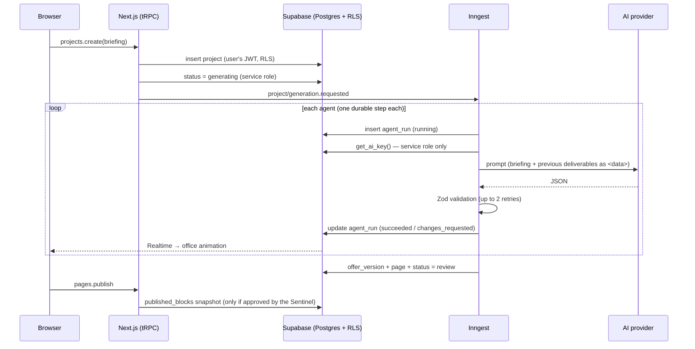

# Architecture

## Overview

## Packages

- **`packages/agents`** — pure TypeScript, no I/O besides the model call. Contains the Zod schemas of every deliverable, the six agent definitions with versioned prompts, `runAgent` (JSON extraction, validation and retries), deterministic safety rules and `runOfferPipeline`, which talks to persistence and durable execution only through two interfaces (`PipelineStore`, `PipelineRuntime`). That is what makes the whole offer flow testable with a fake model and an in-memory store.
- **`apps/worker`** — Inngest functions (`generate-offer`, `review-page`), the Supabase implementation of `PipelineStore` and the key resolution. The decrypted key exists only in memory during an invocation and is never returned from a step (step outputs are persisted by Inngest).
- **`apps/web`** — Next.js App Router. tRPC routers use the **user-scoped** Supabase client for everything RLS can protect, and the service-role client only for the few privileged writes (Vault, status, publish, account deletion), always after an ownership check.
- **`packages/db`** — SQL migrations, TypeScript types and RLS tests that run against plain Postgres with a Supabase shim.
- **`packages/ui`** — shared components, the office (SVG + CSS sprites) and the sales page renderer.

## Data model

| Table | Purpose | Who writes |
| --- | --- | --- |
| `profiles` | name, 18+ confirmation, locale, role | user (name, locale, age), server (role) |
| `ai_keys` | provider, Vault secret pointer, last 4 chars | server only, via `upsert_ai_key()`; user can delete |
| `projects` | name, status, briefing, provider, review mode | user (content), server (status, pipeline fields) |
| `agent_runs` | agent, status, round, prompt version, input/output, tokens, error | server; user can only set `edited_output` |
| `offer_versions` | immutable history: promise, structure, copy, Sentinel report | server |
| `pages` | slug, draft blocks, approval, published snapshot | user (draft blocks), server (slug, approval, publishing) |
| `catalog_offers`, `catalog_sources` | curated reference catalog (Phase 2 UI) | admins |

`creatives` (Phase 2) and `showcase_posts` / `reactions` (Phase 3) will be added with their features.

Trust-sensitive columns are protected with **column-level grants**, not only policies: e.g. `authenticated` can `UPDATE (blocks)` on `pages` but not `approved_at` or `published_blocks`, so a user calling the Supabase API directly still cannot publish without the Sentinel. Editing the draft clears the approval in a trigger.

## Published pages

Pages are JSON blocks validated by Zod and rendered as React text (no user HTML). Visitors read only `published_blocks` through `get_published_page()`, a `SECURITY DEFINER` function that returns no owner data. Middleware serves `<slug>.<NEXT_PUBLIC_PAGES_DOMAIN>` with a nonce-based CSP, `form-action 'none'` and `frame-ancestors 'none'`, and never touches the session.
